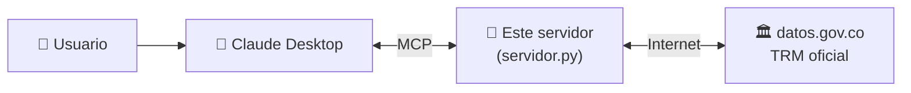

# 🇨🇴 Servidor MCP de Finanzas Colombia


**Un servidor MCP que le da a Claude (o a cualquier asistente compatible) herramientas financieras de Colombia con datos oficiales en tiempo real.**

Con el servidor conectado, le preguntas a Claude Desktop *"¿a cuánto está el dólar hoy?"* o *"¿cuánto pagaría al mes por un crédito de 10 millones al 24,5 % E.A. a 3 años?"*, y Claude usa estas herramientas para responder con el dato oficial y un cálculo exacto.

---

## En 30 segundos

| | |
|---|---|
| **Problema** | Un asistente de IA no sabe el dólar de hoy y puede equivocarse calculando cuotas de crédito. |
| **Solución** | Un servidor **MCP** que le entrega al asistente 4 herramientas: TRM oficial en tiempo real, conversión de moneda y simulador de crédito. |
| **Técnica** | SDK oficial de MCP para Python · consumo de API pública · validación de datos · errores claros para el asistente. |
| **Stack** | Python · MCP SDK · httpx · API de Datos Abiertos de Colombia · pytest |

---

## ¿Qué es MCP?

**MCP (Model Context Protocol)** es un estándar abierto para conectar asistentes de IA con herramientas y datos externos. Funciona como un "USB" para la IA: escribes el servidor una vez y cualquier asistente compatible lo puede usar.



1. Claude Desktop arranca `servidor.py` y le pregunta qué herramientas tiene.
2. Cuando el usuario pregunta algo, Claude decide si necesita una herramienta.
3. Si la necesita, se la pide al servidor; el servidor la ejecuta y le devuelve el resultado.

---

## Las 4 herramientas

| Herramienta | Qué hace |
|---|---|
| `trm_hoy` | Valor oficial del dólar hoy en pesos (TRM), en tiempo real |
| `trm_por_fecha` | TRM de una fecha pasada, por ejemplo 2026-01-15 |
| `convertir_moneda` | Convierte entre dólares y pesos con la TRM de hoy |
| `simular_credito` | Cuota mensual, total pagado e intereses de un préstamo |

La TRM sale de la [API pública de datos.gov.co](https://www.datos.gov.co/resource/32sa-8pi3.json), con el dato oficial de la Superintendencia Financiera. No necesita clave.

---

## Ejemplo

**Pregunta a Claude:** *Simula un crédito de 10.000.000 al 24,5 % E.A. a 36 meses*

**Claude llama a la herramienta** (resultado real del servidor):

```text
🔧 simular_credito(monto=10000000, tasa_efectiva_anual=24.5, plazo_meses=36)

cuota_mensual:           $382.499
total_pagado:         $13.769.964
total_intereses:       $3.769.964
tasa_mensual_porcentaje:   1,843 %
```

**Y si los datos están mal**, el servidor responde con un error claro que Claude le puede explicar al usuario:

```text
🔧 simular_credito(monto=10000000, tasa_efectiva_anual=24.5, plazo_meses=0)
❌ El plazo debe estar entre 1 y 360 meses.
```

### Más preguntas que puedes hacer

- ¿A cuánto está el dólar hoy?
- ¿Cuánto valía el dólar el 1 de enero de 2026?
- Tengo 350 dólares, ¿cuántos pesos son?
- ¿Cuánto me ahorro en intereses si pago el crédito en 24 meses en vez de 36?

---

## Qué demuestra este proyecto

- **Crear un servidor MCP** con el SDK oficial de Python y publicar herramientas con un decorador.
- **Consumir una API pública** en tiempo real, con tiempo de espera y manejo de fallos.
- **Validar los datos de entrada** y devolver errores claros al asistente.
- **Cálculo financiero real**: cuota fija (sistema francés) con la tasa efectiva anual convertida a mensual, como en Colombia.
- **Pruebas automatizadas**, incluida una cuota verificada contra un valor de tabla.

---

## Cómo correrlo

Requisitos: Python 3.12 y [Claude Desktop](https://claude.ai/download).

```bash
git clone https://github.com/BLACKFLANG/mcp-finanzas-colombia.git
cd mcp-finanzas-colombia
py -3.12 -m venv venv
venv\Scripts\activate
pip install -r requirements.txt
```

### Conectarlo a Claude Desktop

1. En Claude Desktop ve a **Configuración → Desarrollador → Editar configuración**. Se abre el archivo `claude_desktop_config.json`.
2. Agrega esto, cambiando `C:\\ruta\\a` por la carpeta donde está el proyecto:

```json
{
  "mcpServers": {
    "finanzas-colombia": {
      "command": "C:\\ruta\\a\\mcp-finanzas-colombia\\venv\\Scripts\\python.exe",
      "args": ["C:\\ruta\\a\\mcp-finanzas-colombia\\servidor.py"]
    }
  }
}
```

3. Cierra y vuelve a abrir Claude Desktop. Las herramientas aparecen en el chat.

### Probarlo sin Claude Desktop

Con el [MCP Inspector](https://github.com/modelcontextprotocol/inspector) (necesita Node.js) puedes ver y probar las herramientas desde el navegador:

```bash
npx @modelcontextprotocol/inspector venv\Scripts\python.exe servidor.py
```

Pruebas: `pytest`

---

## Estructura

```
mcp-finanzas-colombia/
├── servidor.py          # El servidor y sus 4 herramientas
├── requirements.txt
└── tests/
    └── test_servidor.py # Pruebas de los cálculos
```

## Próximos pasos

- Agregar más indicadores: tasa de usura, IPC, UVR.
- Simular un CDT.
- Mostrar la tabla de amortización completa del crédito.

> Las simulaciones son aproximadas y educativas; no reemplazan la cotización de un banco.

📘 Para entender el código paso a paso, lee la [Guía técnica](GUIA_TECNICA.md).

---

## Autor

**Sebastian Bedoya Herrera** · Ingeniero Junior de IA · Medellín, Colombia

Otros proyectos: [Asistente Documental Helios (RAG)](https://github.com/BLACKFLANG/Rag-corporativo-HELIOS) · [Agente Analista de Gastos](https://github.com/BLACKFLANG/agente-analista-gastos)
